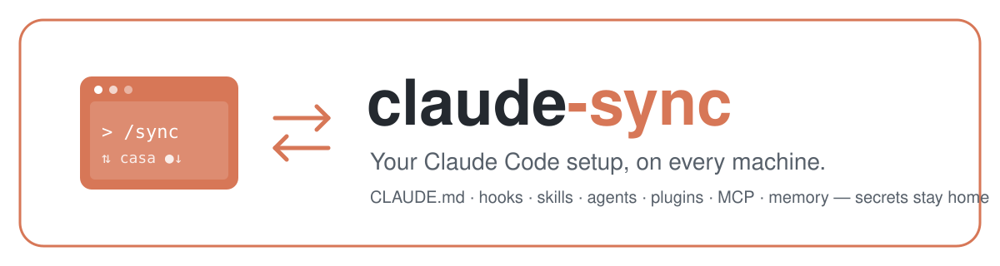
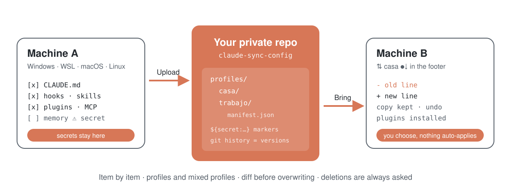
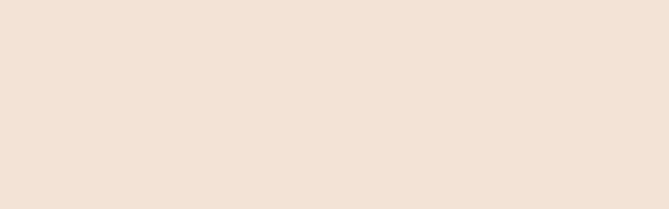
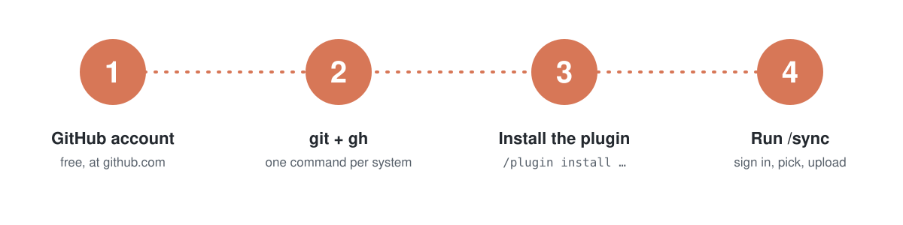
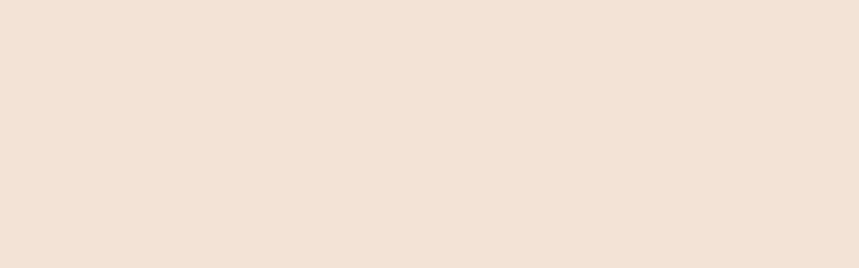
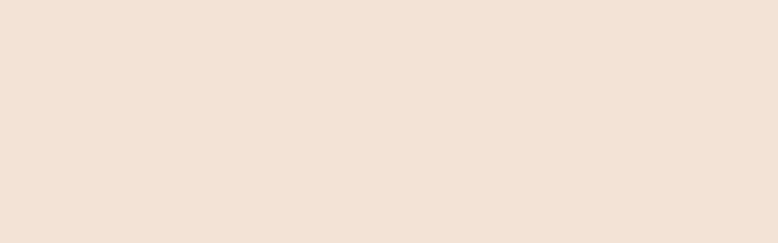
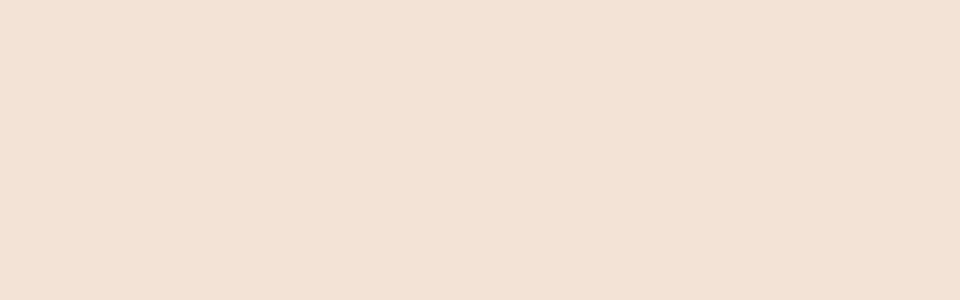
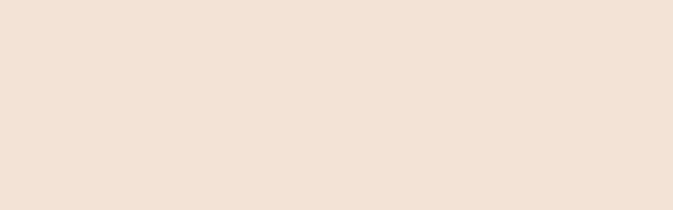
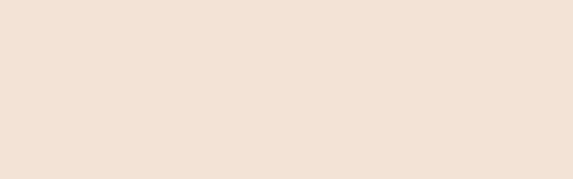

<p align="center"></p>

<p align="center"><a href="README.md">English</a> · <b>Español</b></p>

**claude-sync** guarda tu configuración de Claude Code en un repositorio privado de GitHub tuyo y la recupera en cualquier otro equipo. Eliges pieza a pieza qué se sube y qué se aplica: tu `CLAUDE.md`, cada hook, skill, agente, comando, permiso, plugin (con su configuración), servidor MCP y archivo de memoria. Funciona entero dentro de Claude Code, en Windows, WSL, macOS y Linux.

<p align="center"></p>

## 1. Qué es y qué no sube nunca

- **Tu repo, tu cuenta.** Todo se guarda en `claude-sync-config`, un repositorio privado de tu cuenta de GitHub. No hay servidor ni otra cuenta.
- **Los secretos no salen de tu equipo.** Antes de cada subida se revisa cada elemento:
  - los valores con nombres como `TOKEN`, `KEY`, `SECRET`, `PASSWORD` o `Authorization` (en `env`, servidores MCP y configuración de plugins) se sustituyen por un marcador como `${secret:mcp:github.env.GITHUB_TOKEN}`;
  - se buscan formatos de token conocidos (`ghp_…`, `github_pat_…`, `sk-…`, `xox…`, claves privadas…) en **todos** los archivos. Dentro de texto libre (memoria, skills, `CLAUDE.md`) el elemento se **bloquea**, nunca se edita a tus espaldas, y se te enseña dónde está. Si no es un secreto, puedes decirlo solo para ese texto exacto.
  - En el otro equipo se te pide cada valor que falte, y se queda allí.
- **Nunca se sincroniza:** credenciales, historial, sesiones, transcripciones, cachés, estadísticas, copias de seguridad, cachés de plugins y todas las claves internas de `~/.claude.json` (solo viajan `mcpServers` y la configuración de cada proyecto). `plugins/synced/` tampoco: sus entradas no se pueden asociar a un plugin.
- **Nada se aplica solo.** La barra inferior avisa cuando hay algo nuevo; tú decides, después de ver la diferencia. Nada se borra sin preguntar.

## 2. Instalar git y gh

Necesitas una **cuenta de GitHub** (gratis): créala en [github.com/signup](https://github.com/signup).



Después instala `git` y la herramienta de GitHub `gh` una vez en cada equipo. Abre una terminal y ejecuta el bloque de tu sistema:

**Windows** (PowerShell)

```powershell
winget install --id Git.Git -e
winget install --id GitHub.cli -e
```

**macOS** (con [Homebrew](https://brew.sh))

```bash
brew install git gh
```

**Ubuntu, Debian y WSL**

```bash
sudo apt update && sudo apt install -y git gh
```

Si no encuentra `gh`, sigue [los pasos oficiales para Linux](https://github.com/cli/cli/blob/trunk/docs/install_linux.md).

**Fedora**

```bash
sudo dnf install -y git gh
```

**Arch**

```bash
sudo pacman -S git github-cli
```

Cierra y vuelve a abrir Claude Code para que los vea.

<p align="center"></p>

## 3. Instalar el plugin

En el prompt de Claude Code:

```
/plugin marketplace add Jorditomasg/claude-sync
/plugin install config-sync@claude-sync
```

O en un solo paso (Claude Code 2.1.275 o posterior):

```
/plugin install config-sync --marketplace Jorditomasg/claude-sync
```

Responde `y` si te pregunta si añadir el marketplace y elige el ámbito **user**. Aparece un botón `⇅ sync` abajo a la derecha de Claude Code.

## 4. Primer `/sync`, paso a paso

1. Pulsa el botón `⇅ sync` (terminal a pantalla completa) o escribe `/sync`. Se abre el panel de Claude Sync; se maneja con el teclado: **Tab** / flechas para moverse, **Enter** para pulsar, **Esc** para cerrar.
   
2. El panel comprueba `git` y `gh`. Pulsa **Iniciar sesión en GitHub**: aparecen un código de un solo uso y un enlace; abre el enlace, pega el código y acepta. Si no termina, escribe `! gh auth login` en el prompt y pulsa **Comprobar otra vez**.
   
3. Pulsa **Usar el repositorio `<tú>/claude-sync-config`**. Si no existe, se crea privado.
4. Escribe el nombre de tu primer perfil (por ejemplo `casa`) y pulsa Enter.
5. Aparece el árbol con todo lo que hay en este equipo, por categorías. **Enter** sobre una categoría la abre; **Enter** sobre un elemento lo marca; `todo` / `nada` marcan una categoría entera. Los hooks se llevan consigo los scripts que ejecutan.
   
6. Los elementos `⚠ secreto` no se pueden marcar. Ábrelos para ver el archivo y la línea; quita el token del archivo, o pulsa **No es un secreto** si es una falsa alarma.
   
7. Pulsa **Continuar**. Los elementos se suben en un commit: esa es tu primera versión.

Desde entonces el botón muestra `⇅ casa`, con `●` cuando tienes cambios sin subir y `↓` cuando el repo tiene algo nuevo. El menú del panel:



| Opción | Qué hace |
|---|---|
| Subir cambios | Lo marcado se añade o actualiza. Lo desmarcado se queda como está en el perfil. Lo que borraste aquí solo se quita del perfil si lo confirmas. |
| Traer del repo | Primero pregunta si quieres subir tus cambios pendientes. Enseña la diferencia de cada elemento (por líneas en textos, por campos en ajustes), te deja elegir lado en cada conflicto y después aplica. |
| Cambiar de perfil | Elige otro perfil o crea uno nuevo. |
| Crear perfil mezclando otros | Copia piezas de varios perfiles en uno nuevo e independiente. |
| Historial de versiones | Cada subida es una versión; elige una para recuperarla con la misma revisión. |
| Deshacer la última aplicación | Restaura cada archivo que reemplazó la última aplicación y desinstala los plugins que instaló. |

## 5. En tu segundo equipo

1. Instala `git` y `gh` (sección 2) y el plugin (sección 3).
2. Escribe `/sync`, inicia sesión y pulsa **Usar el repositorio**.
3. Elige tu perfil. Revisa el árbol: lo nuevo viene marcado; lo `⚠ otro sistema` (por ejemplo un hook de PowerShell en un Mac) se queda fuera; los conflictos te piden elegir.
4. Revisa las diferencias y pulsa **Aplicar**. Los ajustes se fusionan en `settings.json` y `~/.claude.json`, nunca se reescriben enteros; se instalan los marketplaces y plugins que falten; se te piden los secretos que este equipo no tenga.
   
5. El resumen dice qué se ha aplicado, qué se ha saltado y por qué. Reinicia Claude Code (o ejecuta `/reload-plugins`) cuando lo pida.
   

Los elementos de proyecto (`.claude/` de un repo, `CLAUDE.md`, `.mcp.json`, memoria del proyecto) se aplican al repo en el que está abierto Claude, o a la carpeta que escribas. Los archivos que ya están en el git de ese proyecto salen marcados `en el git del proyecto`; al aplicarlos aparecen allí como una edición normal, y claude-sync nunca hace commits en tus repos.

## 6. Problemas frecuentes

- **No veo el botón o al pulsarlo no pasa nada.** Los clics necesitan la terminal a pantalla completa de Claude Code. `/sync` abre el mismo panel en cualquier caso.
- **Dice que `git` o `gh` no está instalado** aunque lo instalaste: reinicia Claude Code para que lea el `PATH` nuevo.
- **El inicio de sesión no termina.** Escribe `! gh auth login` en el prompt, síguelo y pulsa **Comprobar otra vez**.
- **Un elemento sale `⚠ secreto`.** Quita el token de ese archivo (memoria, skill…) o marca el hallazgo como **No es un secreto**. Se recuerda solo para ese texto exacto en ese elemento; si el texto cambia, se vuelve a revisar.
- **Se ha saltado un plugin.** Puede que su marketplace lo haya movido o retirado. El resto se aplica; el resumen dice por qué. Si la versión registrada ya no existe, se instala la actual con un aviso.
- **`settings.json` no era válido.** Los elementos que escriben en él se saltan y el archivo no se toca. Si una aplicación dejara un JSON inválido, se restaura todo desde la copia.
- **Quiero volver atrás.** Usa **Deshacer la última aplicación**, o **Historial de versiones** para recuperar cualquier versión anterior.

## Licencia

[MIT](LICENSE) © Jordi Tomás
