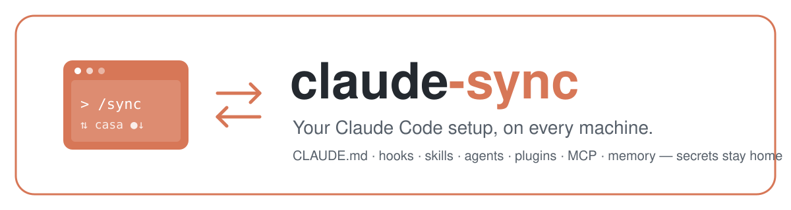
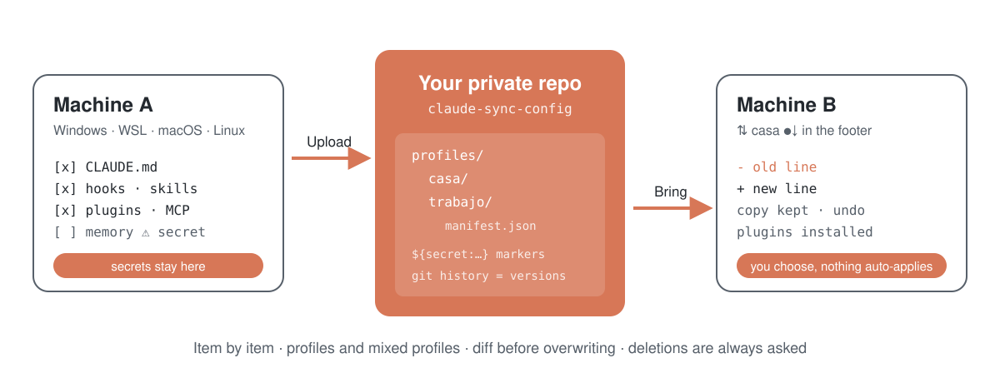
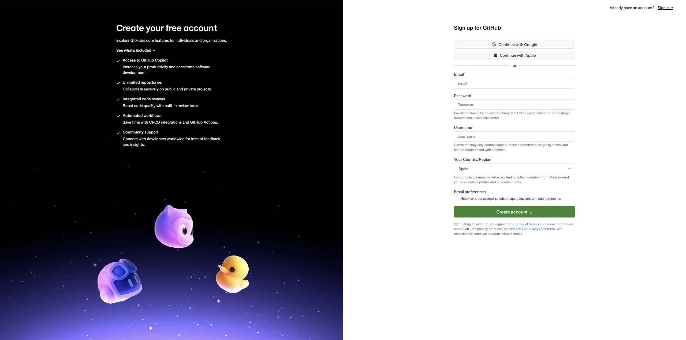
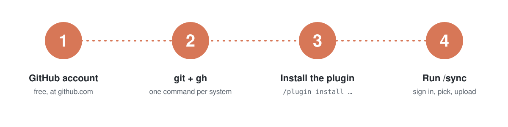
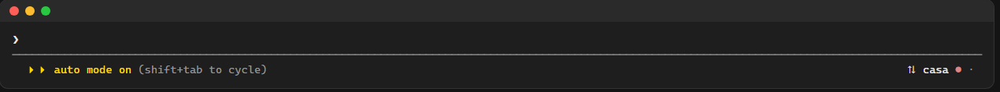
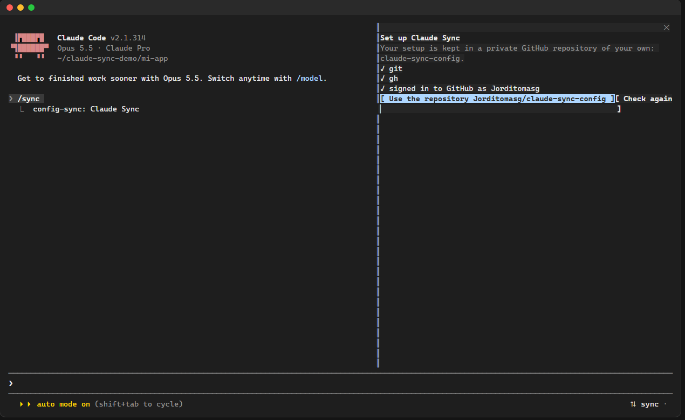
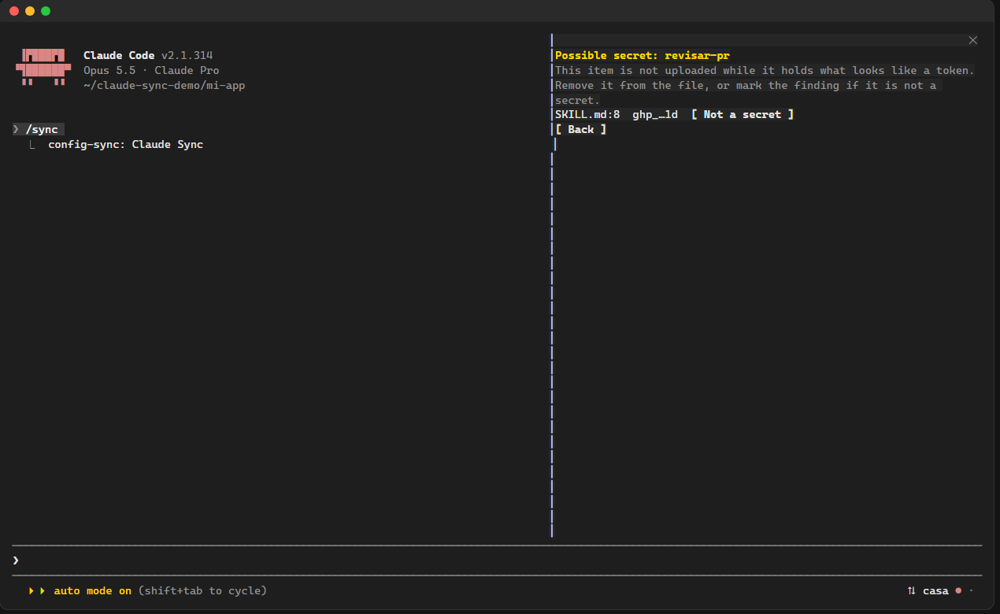
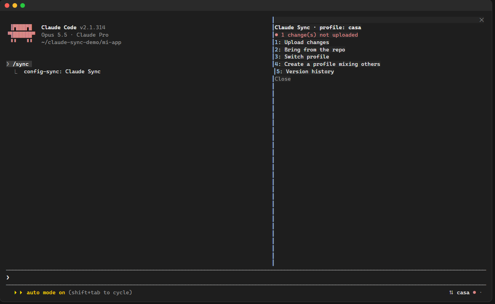
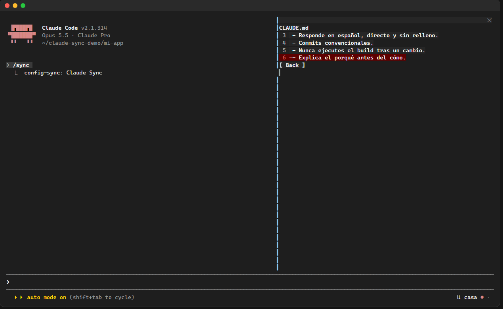

<p align="center"></p>

<p align="center"><b>English</b> · <a href="README.es.md">Español</a></p>

**claude-sync** keeps your Claude Code setup in a private GitHub repository of your own and brings it back on any other machine. You choose piece by piece what goes up and what gets applied: your `CLAUDE.md`, every hook, skill, agent, command, permission, plugin (with its settings), MCP server and memory file. It works entirely inside Claude Code, on Windows, WSL, macOS and Linux.

<p align="center"></p>

## 1. What it is, and what it never uploads

- **Your repo, your account.** Everything is stored in `claude-sync-config`, a private repository in your GitHub account. There is no server and no other account.
- **Secrets never leave your machine.** Before every upload each item is checked:
  - values under names like `TOKEN`, `KEY`, `SECRET`, `PASSWORD` or `Authorization` (in `env`, MCP servers and plugin settings) are replaced by a marker such as `${secret:mcp:github.env.GITHUB_TOKEN}`;
  - known token formats (`ghp_…`, `github_pat_…`, `sk-…`, `xox…`, private keys…) are looked for in **every** file. Inside free text (memory, skills, `CLAUDE.md`) the item is **blocked**, never edited behind your back, and you are shown where. If it is not a secret you can say so for that exact text only.
  - On the other machine you are asked for each missing value, and it stays there.
- **Never synced:** credentials, history, sessions, transcripts, caches, statistics, backups, plugin caches and every internal key of `~/.claude.json` (only `mcpServers` and each project's configuration travel). `plugins/synced/` is not synced either: its entries cannot be tied to a plugin.
- **Nothing is applied on its own.** The footer tells you when there is something new; you decide, after seeing the difference. Nothing is deleted without asking.

## 2. Install git and gh

You need a **GitHub account** (free): sign up at [github.com/signup](https://github.com/signup).



Then install `git` and the GitHub CLI `gh` once per machine. Open a terminal and run the block for your system:

**Windows** (PowerShell)

```powershell
winget install --id Git.Git -e
winget install --id GitHub.cli -e
```

**macOS** (with [Homebrew](https://brew.sh))

```bash
brew install git gh
```

**Ubuntu, Debian and WSL**

```bash
sudo apt update && sudo apt install -y git gh
```

If `gh` is not found, follow [the official Linux steps](https://github.com/cli/cli/blob/trunk/docs/install_linux.md).

**Fedora**

```bash
sudo dnf install -y git gh
```

**Arch**

```bash
sudo pacman -S git github-cli
```

Close and reopen Claude Code afterwards so it sees them.

<p align="center"></p>

## 3. Install the plugin

At the Claude Code prompt:

```
/plugin marketplace add Jorditomasg/claude-sync
/plugin install config-sync@claude-sync
```

Or in one step (Claude Code 2.1.275 or later):

```
/plugin install config-sync --marketplace Jorditomasg/claude-sync
```

Answer `y` if asked to add the marketplace and pick the **user** scope. A `⇅ sync` chip appears at the bottom right of Claude Code.

## 4. First `/sync`, step by step

1. Click the `⇅ sync` chip (fullscreen terminal) or type `/sync`. The Claude Sync panel opens; it is driven with the keyboard: **Tab** / arrows move, **Enter** presses, **Esc** closes.
   
2. The panel checks `git` and `gh`. Press **Sign in to GitHub**: a one-time code and a link appear; open the link, paste the code and accept. If it does not finish, type `! gh auth login` at the prompt and press **Check again**.
   
3. Press **Use the repository `<you>/claude-sync-config`**. It is created private if it does not exist.
4. Type a name for your first profile (for example `home`) and press Enter.
5. You get the tree of everything on this machine, by category. **Enter** on a category opens it; **Enter** on an item ticks it; `all` / `none` tick a whole category. Hooks bring the scripts they run with them.
   
6. Items marked `⚠ secret` cannot be ticked. Open one to see the file and line; remove the token from the file, or press **Not a secret** if it is a false alarm.
   
7. Press **Continue**. The items are uploaded as one commit: that is your first version.

From then on the chip reads `⇅ home`, with `●` when you have changes not uploaded and `↓` when the repo has something new. The panel's menu:



| Entry | What it does |
|---|---|
| Upload changes | Ticked items are added or updated. Unticked ones stay as they are in the profile. Something you deleted here is removed from the profile only if you say so. |
| Bring from the repo | Asks first whether to upload your pending changes. Shows the difference of every item (by line for text, by field for settings), lets you pick a side in each conflict, then applies. |
| Switch profile | Pick another profile, or create a new one. |
| Create a profile mixing others | Copies pieces of several profiles into a new, independent one. |
| Version history | Every upload is a version; pick one to bring it back through the same review. |
| Undo the last apply | Puts back every file the last apply replaced and uninstalls the plugins it installed. |

## 5. On your second machine

1. Install `git` and `gh` (section 2) and the plugin (section 3).
2. Type `/sync`, sign in and press **Use the repository**.
3. Pick your profile. Review the tree: new items are ticked; `⚠ other system` items (for example a PowerShell hook on a Mac) are left out; conflicts ask you to choose.
4. Check the differences and press **Apply**. Settings are merged into `settings.json` and `~/.claude.json`, never rewritten whole; missing marketplaces and plugins are installed; you are asked for any secret this machine lacks.
   
5. The summary says what was applied, what was skipped and why. Restart Claude Code (or run `/reload-plugins`) when it asks.
   

Project items (`.claude/` of a repo, `CLAUDE.md`, `.mcp.json`, project memory) apply to the repo Claude is open in, or to the folder you type. Files already tracked by that project's own git are marked `in the project's git`; applying them shows up there as a normal edit, and claude-sync never commits in your repos.

## 6. Troubleshooting

- **I do not see the chip, or clicking does nothing.** Clicks need Claude Code's fullscreen terminal. `/sync` opens the same panel everywhere.
- **`git` or `gh` is not installed** even after installing: restart Claude Code so it picks up the new `PATH`.
- **Sign-in does not finish.** Type `! gh auth login` at the prompt, follow it, then press **Check again**.
- **An item is `⚠ secret`.** Remove the token from that file (memory, skill…) or mark the finding **Not a secret**. It is remembered only for that exact text in that item; if the text changes, it is checked again.
- **A plugin was skipped.** Its marketplace may have moved or dropped it. The rest is applied; the summary says why. When the recorded version no longer exists the current one is installed with a warning.
- **`settings.json` was invalid.** Items that write to it are skipped and the file is left untouched. If an apply ever leaves a JSON file invalid, everything is restored from the copy.
- **I want to go back.** Use **Undo the last apply**, or **Version history** to bring any earlier version.

## License

[MIT](LICENSE) © Jordi Tomás
